# Cloud Lab 2 Submission — Load Balancer and Auto Scaling

Lab instructions: [lab2-instruction.md](https://github.com/RathpiseyAlpha/ITC-I5GIC-CC/blob/main/labs/lab2/lab2-instruction.md)

- **Student name:** Huy Chanchhinghoir
- **Student ID:** e20221469
- **Learner Lab user name:** voclabs/user5619305=HUY_CHANCHHINGHOIR
- **Date completed:** 2026-11-05

---

## Security groups

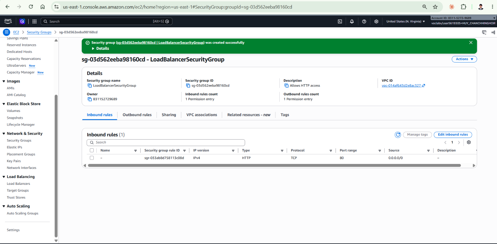

`LoadBalancerSecurityGroup` (`sg-03d562eeba98160cd`) is in the default VPC `vpc-014af643d2e8ac327`. It has one inbound rule: **HTTP, TCP 80, from `0.0.0.0/0`**.

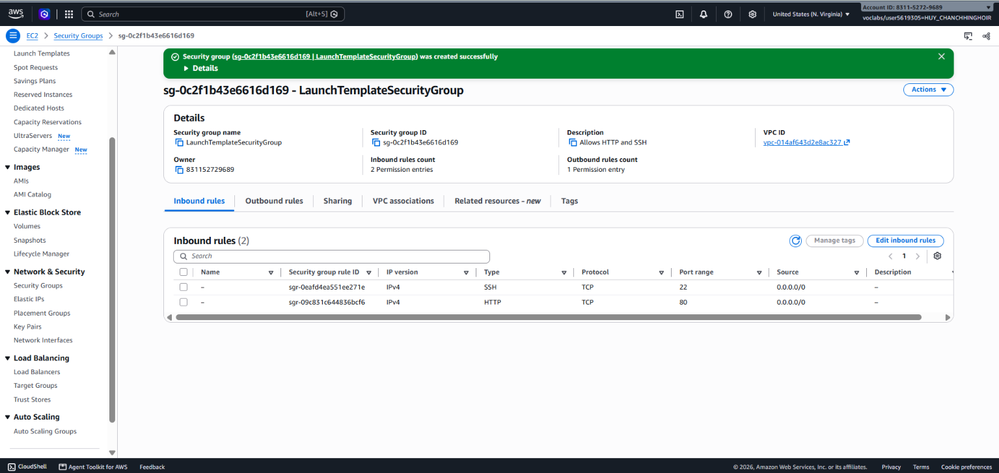

`LaunchTemplateSecurityGroup` (`sg-0c2f1b43e6616d169`) is in the same VPC. It has two inbound rules: **SSH (22)** and **HTTP (80)**, both from `0.0.0.0/0`.

## Target group

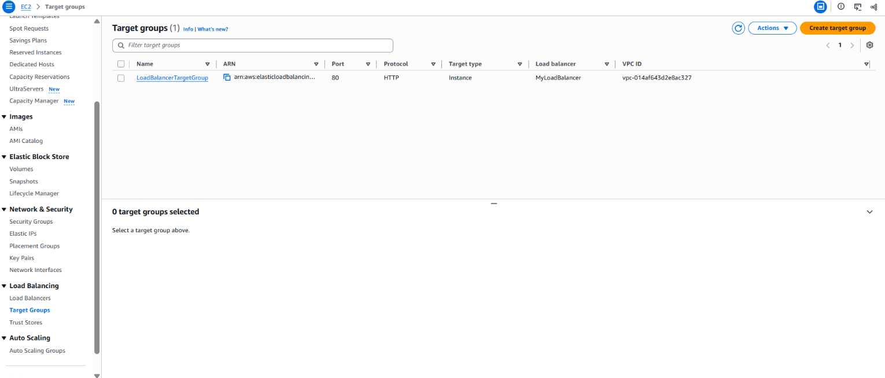

`LoadBalancerTargetGroup`: target type **Instance**, protocol **HTTP**, port **80**, default VPC `vpc-014af643d2e8ac327`. After Task 3 it is attached to `MyLoadBalancer`.

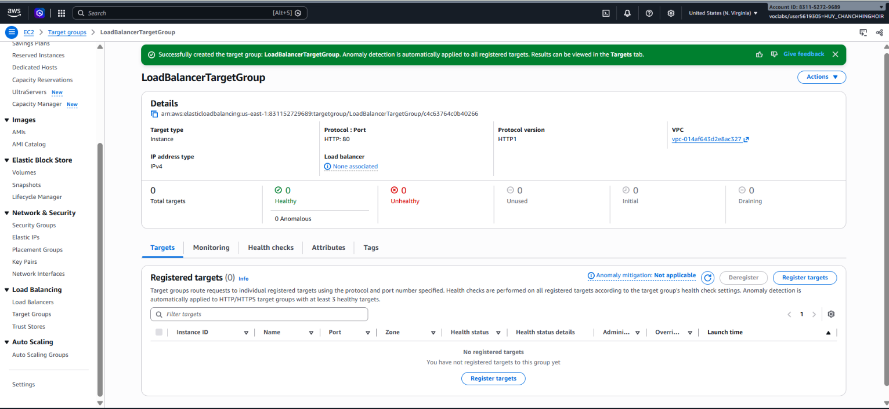

I kept the default health checks: protocol HTTP, path `/`, interval 30 seconds, timeout 5 seconds, healthy threshold 5, unhealthy threshold 2, success code 200. No targets were registered when I created the group.

## Application Load Balancer

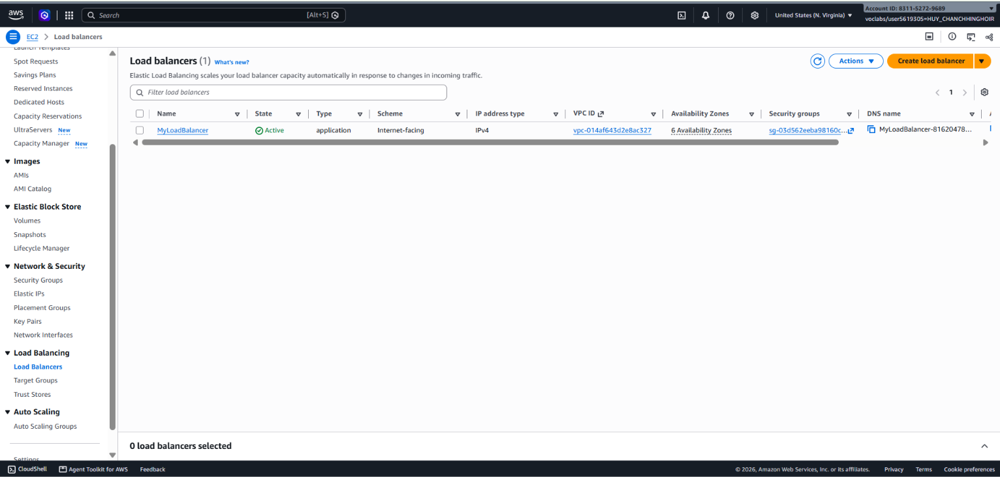

`MyLoadBalancer` is **Active**. It is of type `application`, *Internet-facing*, IPv4, in 6 Availability Zones, with security group `sg-03d562eeba98160cd` (`LoadBalancerSecurityGroup`).

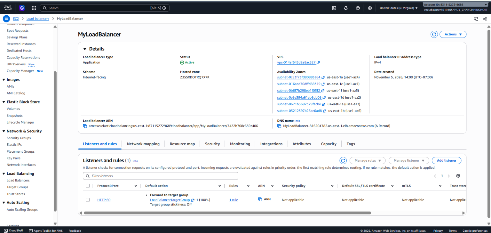

The scheme is **Internet-facing**, with one subnet in each of `us-east-1a` to `us-east-1f`. The DNS name is `MyLoadBalancer-816204782.us-east-1.elb.amazonaws.com`. The listener **HTTP:80** forwards 100% of requests to `LoadBalancerTargetGroup`, and stickiness is off.

## Launch template

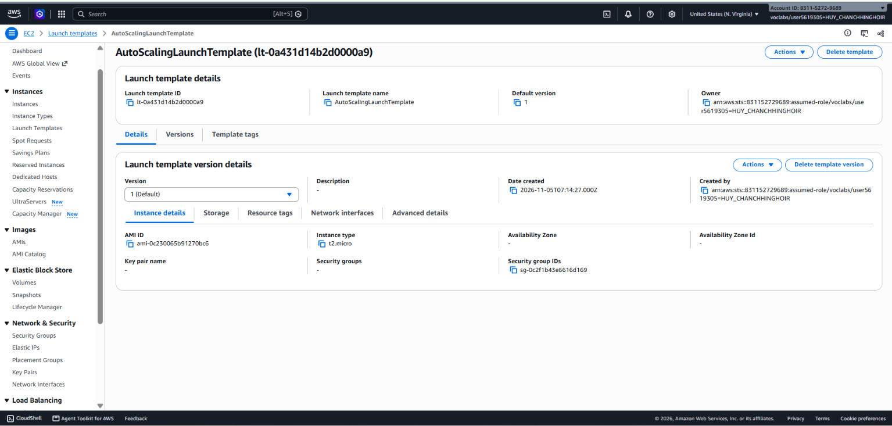

`AutoScalingLaunchTemplate` (`lt-0a431d14b2d0000a9`, version 1):

- AMI: `ami-0c230065b91270bc6` (Amazon Linux 2023; the Instance Connect banner in screenshot 12 confirms it)
- Instance type: `t2.micro`
- Security group: `sg-0c2f1b43e6616d169` (`LaunchTemplateSecurityGroup`)

User data (Advanced details):

```bash
#!/bin/bash
# Enabling admin rights
sudo su
# Updating system and installing httpd
yum update -y
yum install -y httpd.x86_64
# Launching a simple httpd server
systemctl start httpd.service
systemctl enable httpd.service
# Writing HTML file to serve on the httpd server
echo "Hello World from ($(hostname))" > /var/www/html/index.html
```

## Auto Scaling group

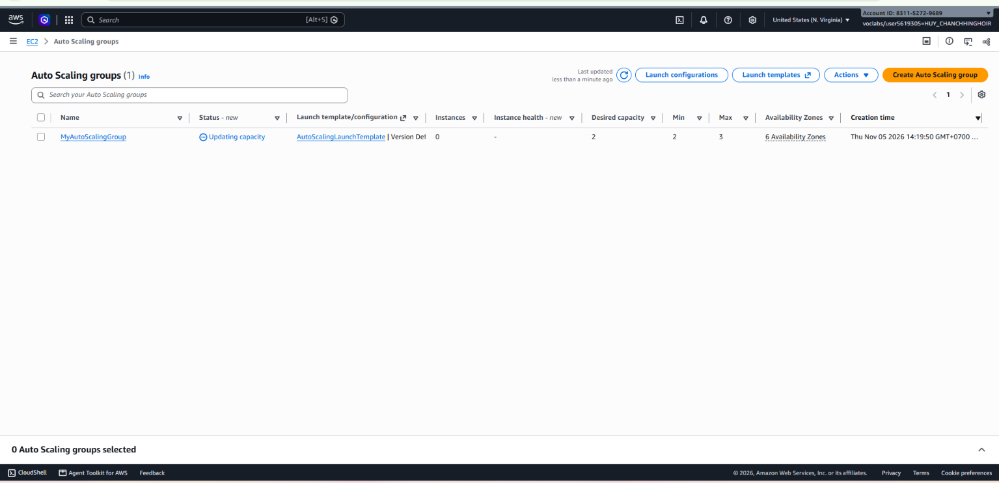

Right after I created `MyAutoScalingGroup`, it uses `AutoScalingLaunchTemplate` and spans 6 Availability Zones, with desired 2, min 2 and max 3. Its status is *Updating capacity* and it has 0 instances, because it has just started launching them.

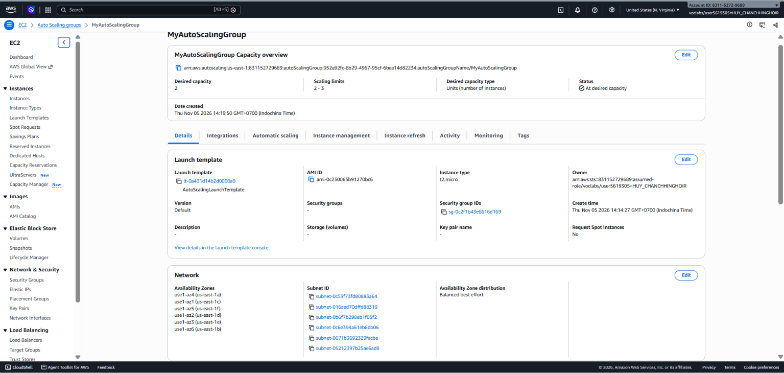

The desired capacity is **2** and the scaling limits are **2 – 3**. The status is *At desired capacity*. The group uses `lt-0a431d14b2d0000a9` (t2.micro, `sg-0c2f1b43e6616d169`) and the default subnets in all six zones. It is attached to `LoadBalancerTargetGroup` with Elastic Load Balancing health checks turned on.

## Load balancing test

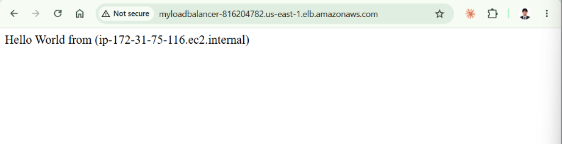

`http://myloadbalancer-816204782.us-east-1.elb.amazonaws.com` → **Hello World from (ip-172-31-75-116.ec2.internal)**

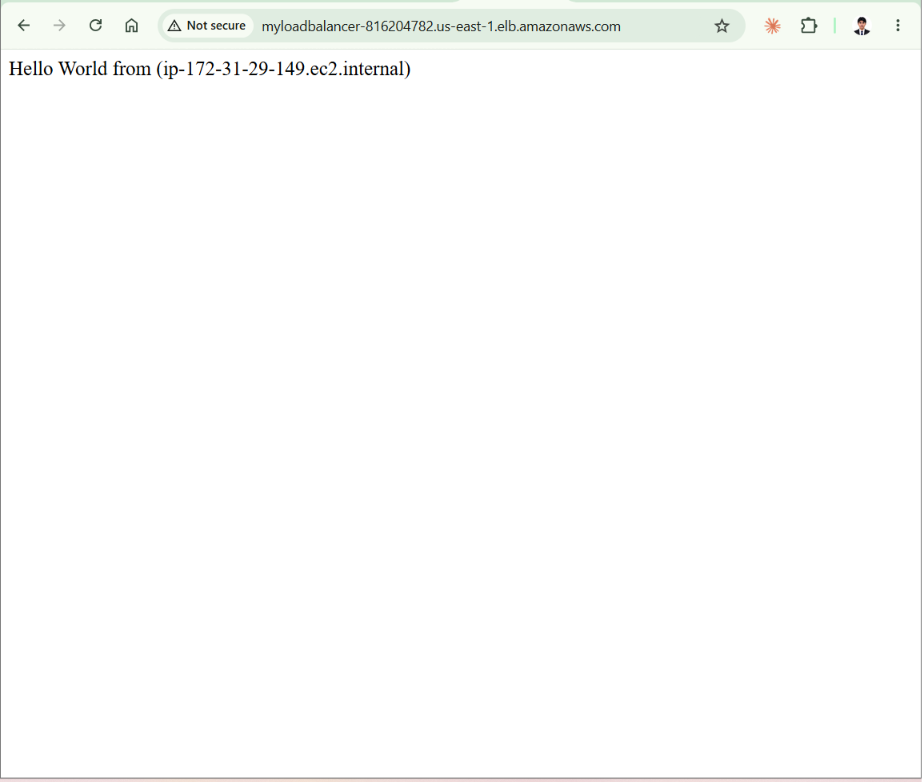

Same address after a refresh → **Hello World from (ip-172-31-29-149.ec2.internal)**. A different instance answered.

## Simulated application failure

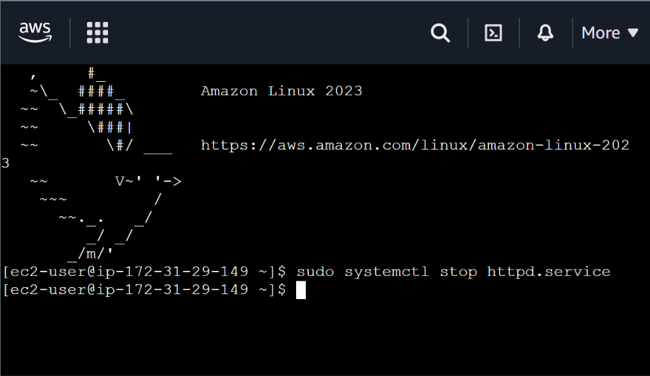

I connected with EC2 Instance Connect to `ip-172-31-29-149`, the instance from the second request, and ran `sudo systemctl stop httpd.service`. The instance kept running, but nothing listened on port 80 any more.

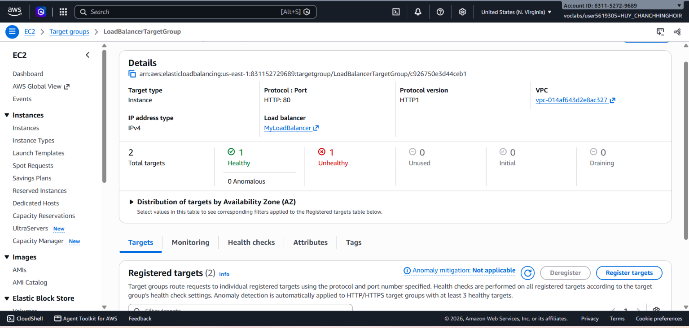

A few minutes later, `LoadBalancerTargetGroup` shows 2 targets: **1 Healthy** and **1 Unhealthy**, the instance where I stopped `httpd`.

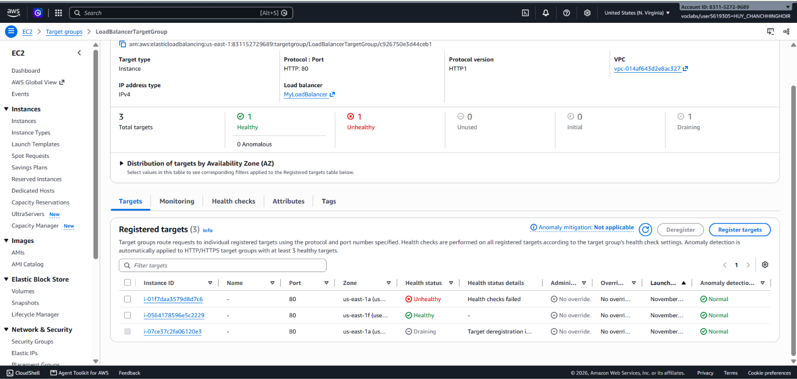

The Auto Scaling group then replaced the failed instance. The target group shows 3 targets:

| Instance | Zone | Health status | Role |
| --- | --- | --- | --- |
| `i-07ce37c2fa06120e3` | us-east-1a | Draining | The failed instance, being deregistered after the ASG terminated it |
| `i-0564178596e5c2229` | us-east-1f | Healthy | The other original instance, still serving traffic |
| `i-01f7daa3579d8d7c6` | us-east-1a | Unhealthy (health checks failed) | The new instance from the launch template. Its user data was still running `yum update` and had not started `httpd` yet |

About how many minutes passed between stopping `httpd` and the new instance becoming healthy?

About 5 minutes. I stopped `httpd` at about 14:33. The target was *Unhealthy* by 14:36, after its failed health checks. By 14:38 the Auto Scaling group had terminated it (*Draining*) and registered a replacement. The replacement was still running its user data (`yum update`, then installing `httpd`), so it passed its health checks shortly after that.

---

## Questions

1. Why does the page show a different host name when you refresh it?
2. After you stopped `httpd`, the instance was still *running* in EC2, but the target group marked it *unhealthy*. What did the health check test, and why did the instance fail it?
3. Who replaced the failed instance: the load balancer, the target group, or the Auto Scaling group? Explain the role of each one.
4. With desired 2, minimum 2 and maximum 3, how many instances run normally? In what situation could there be 3?
5. The instances' security group allows HTTP from anywhere. How could you change it so that the instances accept HTTP **only** from the load balancer?

### Answers

1. The load balancer routes each request on its own. By default it uses **round robin** over the healthy targets in `LoadBalancerTargetGroup`, and stickiness is off, so the next request can go to the other instance. Each instance wrote its own host name into `index.html` when its user data ran (`$(hostname)`), so the page shows which instance answered. I saw `ip-172-31-75-116` first and `ip-172-31-29-149` after refreshing.
2. The health check tests the **application**, not the virtual machine. Every 30 seconds the load balancer sends `HTTP GET /` to port 80 on each target and expects a **200** response. After I stopped `httpd`, nothing listened on port 80, so the checks failed. After **2** failed checks in a row, the target became *unhealthy*. EC2 still showed the instance as *running*, because EC2 status checks only test the hardware, the network and the operating system, and these were still fine.
3. The **Auto Scaling group** replaced it.
   - The **load balancer** is the single entry point. Its listener (HTTP:80) receives client requests and forwards them only to healthy targets. Once the instance was unhealthy, it stopped sending traffic there.
   - The **target group** is the list of registered instances. It runs the health checks and reports each target as healthy or unhealthy. It does not launch or terminate instances.
   - The **Auto Scaling group** uses the target group's health status, because I turned on Elastic Load Balancing health checks. It marked the instance unhealthy and terminated it (which deregisters it, hence *Draining*). Then it launched a new instance from `AutoScalingLaunchTemplate` to get back to the desired capacity of 2. The new instance registered in the target group automatically.
4. Normally **2** instances run, the desired capacity. There can be 3 if the desired capacity is raised: by hand, or by a scaling policy (for example, target tracking on CPU or on requests per target) when the load grows. The maximum of 3 stops the group from going higher. The minimum of 2 keeps at least 2 running. In my screenshot 14, the target group also lists 3 targets for a short time. The old instance is still *draining* (the deregistration delay is 300 seconds by default) while its replacement is registered, but the ASG itself has only 2 instances in service.
5. Edit `LaunchTemplateSecurityGroup`'s inbound HTTP rule. Change its source from `0.0.0.0/0` to the **security group** `LoadBalancerSecurityGroup` (`sg-03d562eeba98160cd`). Then port 80 accepts only traffic from network interfaces that have that security group, which means the load balancer's nodes. The load balancer's requests and health checks still work, but opening an instance's public IP directly in a browser would time out. SSH can be limited the same way, for example to my own IP address.

## Clean up

- [ ] `MyAutoScalingGroup` deleted and its instances terminated.
- [ ] `AutoScalingLaunchTemplate` deleted.
- [ ] `MyLoadBalancer` and `LoadBalancerTargetGroup` deleted.
- [ ] Both security groups deleted.
