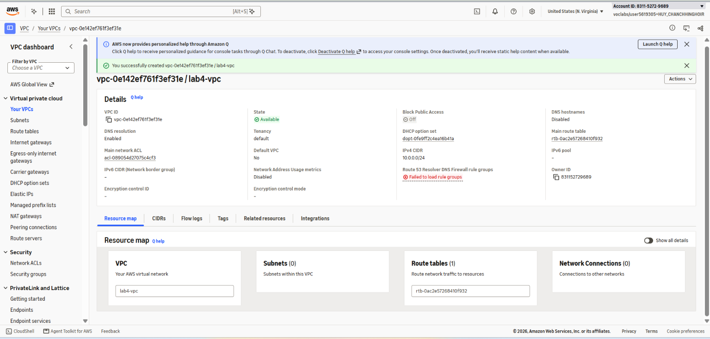
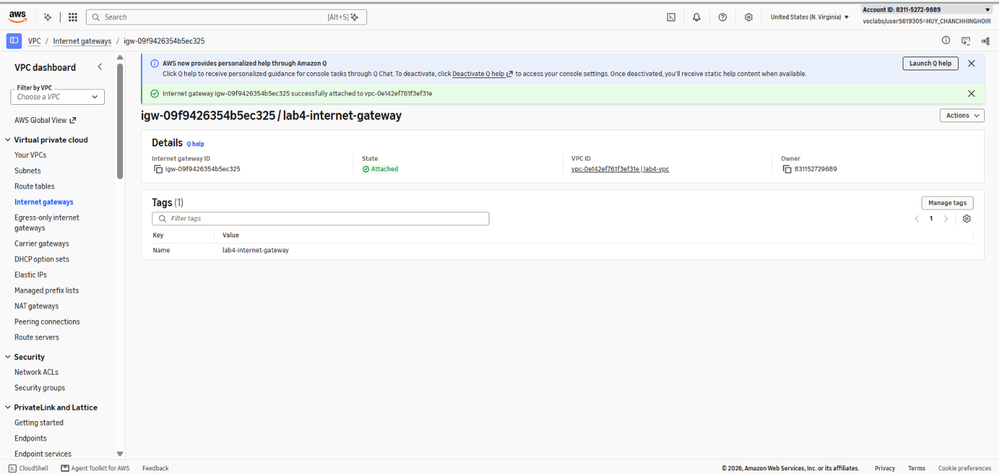
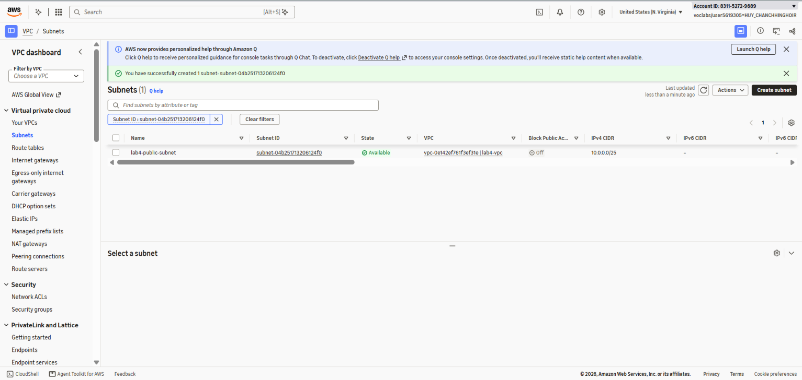
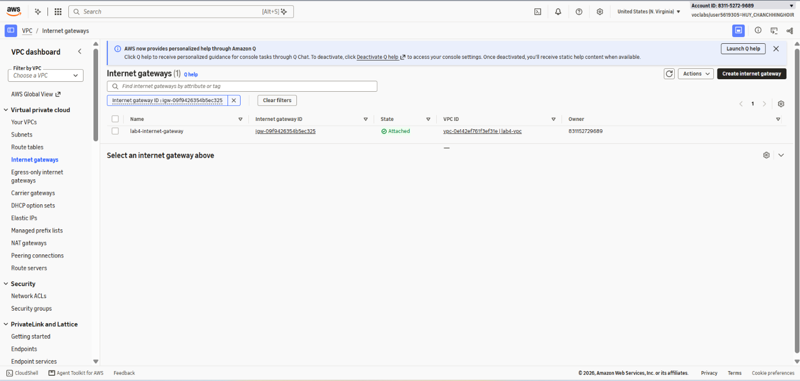
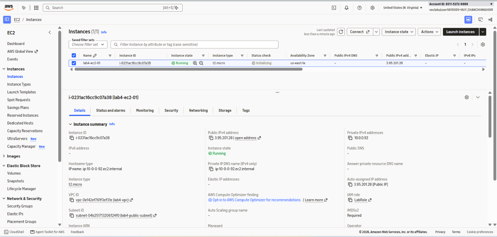
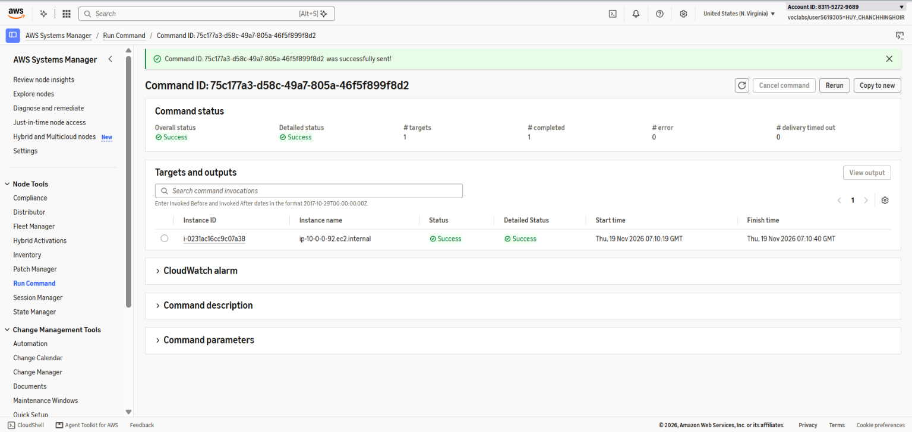
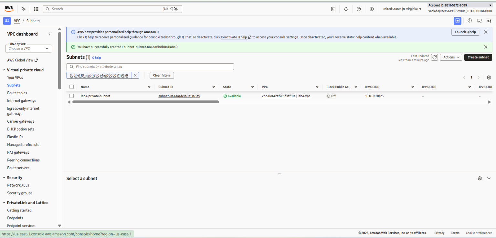
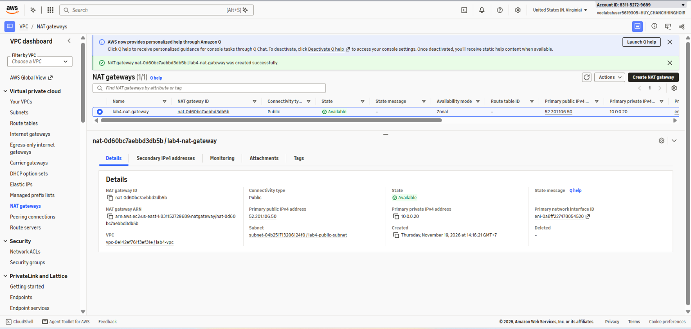
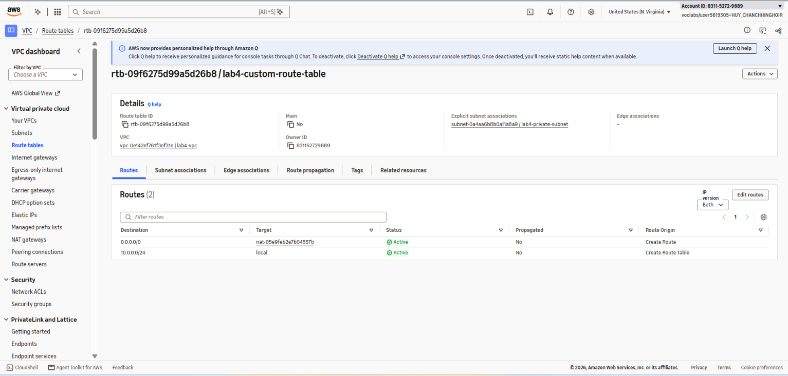
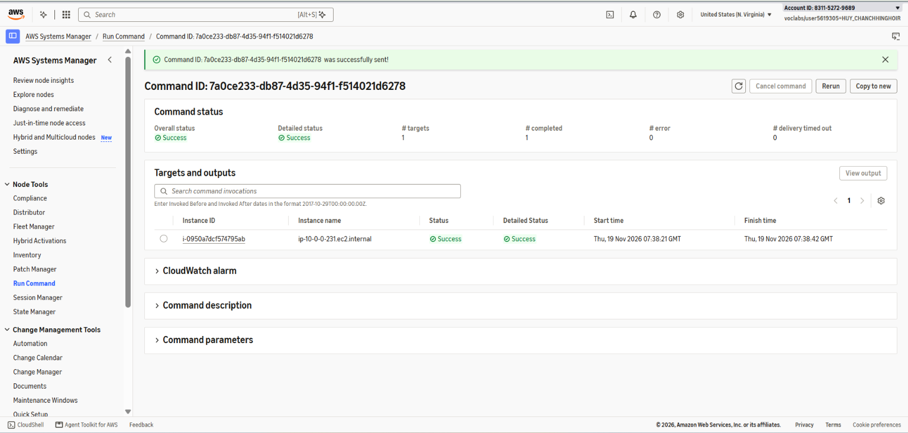

# Cloud Lab 4 Submission — Amazon VPC with Public and Private Subnets

Lab instructions: [Cloud Lab 4 — Amazon VPC with Public and Private Subnets](https://github.com/RathpiseyAlpha/ITC-I5GIC-CC/blob/main/labs/lab4/lab4-instruction.md)

- **Student name:** Huy Chanchhinghoir
- **Student ID:** e20221469

- **Region:** US East (N. Virginia) `us-east-1`

## Lab objectives

This lab demonstrates how to:

1. Create a VPC and attach an internet gateway.
2. Create public and private subnets.
3. Configure route tables for an internet gateway and a NAT gateway.
4. Give a private-subnet instance outbound internet access without a public IP.
5. Test both instances with AWS Systems Manager Run Command.

All console screenshots must show the Learner Lab user name at the top-right. Screenshots should be taken before cleanup.

## Submission tree

```text
cc-gic-e20221469/
└── cc-lab-e20221469/
    └── lab4/
        ├── README.md
        └── images/
            ├── 01-vpc.png
            ├── 02-internet-gateway.png
            ├── 03-public-subnet.png
            ├── 04-public-route-table.png
            ├── 05-ec2-public.png
            ├── 06-test-public.png
            ├── 07-private-subnet.png
            ├── 08-nat-gateway.png
            ├── 09-private-route-table.png
            ├── 10-ec2-private.png
            └── 11-test-private.png
```

## Screenshot checklist

| File | Task | Required evidence |
|---|---:|---|
| `01-vpc.png` | 1 | `lab4-vpc`, CIDR `10.0.0.0/24` |
| `02-internet-gateway.png` | 2 | `lab4-internet-gateway` attached to `lab4-vpc` |
| `03-public-subnet.png` | 3 | `lab4-public-subnet`, CIDR `10.0.0.0/25` |
| `04-public-route-table.png` | 4 | `0.0.0.0/0` routes to `lab4-internet-gateway` |
| `05-ec2-public.png` | 5 | `lab4-ec2-01` running in the public subnet with a public IP |
| `06-test-public.png` | 6 | SSM Run Command `Success` for `lab4-ec2-01` |
| `07-private-subnet.png` | 7 | `lab4-private-subnet`, CIDR `10.0.0.128/25` |
| `08-nat-gateway.png` | 8 | Available `lab4-nat-gateway` in the public subnet with an Elastic IP |
| `09-private-route-table.png` | 9 | `0.0.0.0/0` routes to `lab4-nat-gateway` |
| `10-ec2-private.png` | 10 | `lab4-ec2-02` running with no public IPv4 address |
| `11-test-private.png` | 11 | SSM Run Command `Success` for `lab4-ec2-02` |

## Task 1 — Create a VPC



| Setting | Value |
|---|---|
| Name | `lab4-vpc` |
| IPv4 CIDR | `10.0.0.0/24` |
| IPv6 CIDR | None |
| Tenancy | Default |

## Task 2 — Create and attach an internet gateway



I created `lab4-internet-gateway` and attached it to `lab4-vpc`. An internet gateway provides the VPC's path to and from the public internet when a route table sends traffic to it.

## Task 3 — Create the public subnet



| Setting | Value |
|---|---|
| Name | `lab4-public-subnet` |
| Availability Zone | `us-east-1a` |
| IPv4 CIDR | `10.0.0.0/25` |

## Task 4 — Configure the public route table



I added the following route and explicitly associated the route table with `lab4-public-subnet`:

| Destination | Target |
|---|---|
| `10.0.0.0/24` | `local` |
| `0.0.0.0/0` | `lab4-internet-gateway` |

The default route makes the subnet public. An instance also needs a public IPv4 address and suitable security-group rules to use this path.

## Task 5 — Launch the public-subnet instance



| Setting | Value |
|---|---|
| Name | `lab4-ec2-01` |
| AMI | Amazon Linux 2, 64-bit x86 |
| Instance type | `t2.micro` |
| Subnet | `lab4-public-subnet` |
| Auto-assign public IP | Enabled |
| IAM instance profile | `LabInstanceProfile` |
| Root volume | 8 GiB gp2 |

I removed the default inbound security-group rule because SSM does not require an inbound SSH rule.

## Task 6 — Test public internet access with SSM



In Systems Manager Run Command, I selected **AWS-RunShellScript**, targeted `lab4-ec2-01`, and ran:

```bash
sudo yum update -y
```

The command completed with **Success**, showing that the public-subnet instance could download updates through the internet gateway.

## Task 7 — Create the private subnet



| Setting | Value |
|---|---|
| Name | `lab4-private-subnet` |
| Availability Zone | `us-east-1a` |
| IPv4 CIDR | `10.0.0.128/25` |

The subnet is private because its default route will point to a NAT gateway rather than directly to the internet gateway, and its instance will not receive a public IP address.

## Task 8 — Create the NAT gateway



I created `lab4-nat-gateway` with these settings:

| Setting | Value |
|---|---|
| Subnet | `lab4-public-subnet` |
| Connectivity type | Public |
| Elastic IP | Allocated to the NAT gateway |
| Final state | Available |

The NAT gateway must be in the public subnet so it can send translated traffic to the internet gateway.

## Task 9 — Configure the private route table



I created `lab4-custom-route-table`, added the default route below, and explicitly associated it with `lab4-private-subnet`:

| Destination | Target |
|---|---|
| `10.0.0.0/24` | `local` |
| `0.0.0.0/0` | `lab4-nat-gateway` |

The NAT gateway allows outbound connections from the private subnet while preventing unsolicited inbound connections from the internet.

## Task 10 — Launch the private-subnet instance


| Setting | Value |
|---|---|
| Name | `lab4-ec2-02` |
| AMI | Amazon Linux 2, 64-bit x86 |
| Instance type | `t2.micro` |
| Subnet | `lab4-private-subnet` |
| Auto-assign public IP | Disabled |
| IAM instance profile | `LabInstanceProfile` |
| Root volume | 8 GiB gp2 |

The instance has no public IPv4 address. It reaches the internet only through the private route table and NAT gateway.

## Task 11 — Test private internet access with SSM



I repeated the SSM test for `lab4-ec2-02` with:

```bash
sudo yum update -y
```

The command completed with **Success**. This confirms that the private instance reached the internet through the NAT gateway without having a public IP address.

## Questions and answers

### 1. What makes a subnet public or private?

A subnet is public when its route table has a default route to an internet gateway and its resources have a usable public address. A subnet is private when it does not route directly to the internet gateway. In this lab, the private subnet uses a NAT gateway for outbound internet access.

### 2. Why is the NAT gateway in the public subnet?

The NAT gateway needs its own route to the internet gateway. Placing it in the public subnet gives it that route, allowing it to translate outbound traffic from the private subnet and send the traffic to the internet.

### 3. Why does the private instance not need a public IP?

The NAT gateway provides the public connectivity on behalf of the private instance. The instance initiates the connection using its private address, and return traffic is translated back by the NAT gateway.

### 4. What is the difference between an internet gateway and a NAT gateway?

An internet gateway provides direct internet connectivity for resources with public addresses and supports inbound and outbound traffic. A public NAT gateway translates outbound connections from private resources; it does not allow unsolicited inbound connections to those private resources.

### 5. What proves that the private instance had internet access?

The successful SSM command `sudo yum update -y` proves that `lab4-ec2-02` downloaded package metadata and updates through the NAT gateway. The EC2 screenshot separately proves that the instance had no public IPv4 address.

## Clean up

Cleanup must be completed after all screenshots have been taken:

- [ ] Terminate `lab4-ec2-01` and `lab4-ec2-02`.
- [ ] Remove the `0.0.0.0/0` routes from both route tables.
- [ ] Delete `lab4-nat-gateway`.
- [ ] Wait until the NAT gateway is deleted, then release its Elastic IP.
- [ ] Detach and delete `lab4-internet-gateway`.
- [ ] Delete `lab4-vpc`.
- [ ] Confirm that no Lab 4 resources remain and that the Elastic IP was released.
